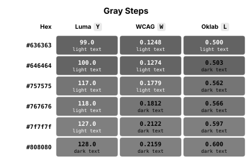
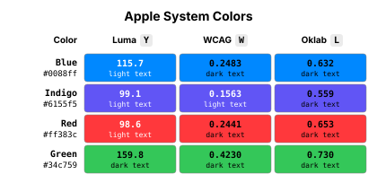

# Luma: Apple & Perceived Brightness

Apple uses [luma](#Luma) (perceived brightness) to set text color based on background color. Apple divides the full luma range into equal halves, providing a simple and consistent decision boundary.

When Safari uses a webpage <nobr><code>background-color</code></nobr> to color browser UI, it also calculates the <nobr><code>background-color</code></nobr> luma to set browser UI text color:

- **luma ≤ 127.5**: \
background is considered **dark** → Safari uses **light text**
- **luma > 127.5**: \
background is considered **light** → Safari uses **dark text**

## Luma

Rec. 709 ([ITU Recommendation BT.709][ITU]) is the international standard for <abbr title="high-definition television">HDTV</abbr>. It defines how to calculate luma from the red, green and blue values of a color.

Luma is a weighted sum of gamma-encoded RGB values. In video, it represents the brightness of an image: its black-and-white part. Luma is not the same as relative luminance, which applies weights to linear RGB values, and it does not exactly represent the luminance of an image ([Wikipedia: Luma][wiki]). Of the three Rec. 709 weights, green is the largest and blue is the smallest.

### Luma Formula

```
Y = ( 0.2126 × R ) + ( 0.7152 × G ) + ( 0.0722 × B )
````

&nbsp;   | variable | range | weight
---------|----------|-------|-------
Red      | `R`      | 0-255 | 21.26%
Green    | `G`      | 0-255 | 71.52%
Blue     | `B`      | 0-255 |  7.22%
**Luma** | **`Y`**  | 0-255 |


### Examples

| HTML Color | HEX Color | `R` | `G` | `B` | `Y` | Text Color
|-------|-----|---|---|---|----------|-------|
| Black | `#000000` | 0 | 0 | 0 | 0.00 | light |
| Blue | `#0000FF` | 0 | 0 | 255 | 18.41 | light |
| Red | `#FF0000` | 255 | 0 | 0 | 54.21 | light |
| Gray | `#7F7F7F` | 127 | 127 | 127 | 127.00 | light |
| Gray | `#808080` | 128 | 128 | 128 | 128.00 | dark |
| Green | `#00FF00` | 0 | 255 | 0 | 182.38 | dark |
| White | `#FFFFFF` | 255 | 255 | 255 | 255.00 | dark |

### Implementation Example

```javascript
function selectThemeWithLuma(bgColor) {
  // remove leading #
  let hex = bgColor.replace(/^#/, '');

  // parse RGB components from hex
  const r = parseInt(hex.substring(0, 2), 16);
  const g = parseInt(hex.substring(2, 4), 16);
  const b = parseInt(hex.substring(4, 6), 16);

  // calculate Rec. 709 Luma using standard coefficients
  const Y = 0.2126 * r + 0.7152 * g + 0.0722 * b;

  // threshold at midpoint: 127.5
  // Y ≤ 127.5 = dark background, use light text
  // Y > 127.5 = light background, use dark text
  return Y <= 127.5;
}
```

## Alternatives

### WCAG Relative Luminance
<abbr title="World Wide Web Consortium">W3C</abbr> Web Content Accessibility Guidelines (WCAG) define [relative luminance][WCAG] from 0 (black) to 1 (white), using the Rec. 709 weights on linearized sRGB values. At level AA, the [contrast ratio][ratio] between text and background must be [at least 4.5:1, or 3:1 for large text][minimum] (18 pt, or 14 pt bold). Above a relative luminance of about `0.179`, black text has a higher ratio than white text ([Lea Verou][verou], an editor of W3C’s [CSS Color specifications][css5]).

### Oklab Lightness

[Oklab], by Björn Ottosson, is designed to predict perceived lightness, chroma and hue. Its `L` is perceived lightness on a [scale from 0 to 1][css], with `0.5` at the midpoint.

### Comparison

| Feature | ITU Rec. 709 <br> Luma | WCAG <br> Relative Luminance | Oklab <br> Lightness |
|---------|---------------|-------------------------|-----------------|
| Linearizes sRGB | No | Yes | Yes, then converts to Oklab |
| Output Range | 0-255 | 0-1 | 0-1 |
| Dark Text Cut-off | > 127.5 | > 0.179 | > 0.5 |
| Defined For | Video signals | Contrast ratios | Image processing |

### [Luma vs. WCAG vs. Oklab][vs.]

Each cell uses the text color that its method selects.

#### Gray Steps

Three pairs of grays, each one RGB step apart.



#### Apple System Colors

Light appearance values from Apple’s [Human Interface Guidelines][HIG] (June 2025).



source: [Compare Web-Safe Colors][vs.]

## References

- [ITU-R Recommendation BT.709][ITU]
- [W3C WCAG 2.2: relative luminance][WCAG]
- [W3C: Understanding Contrast (Minimum)][readability]
- [Wikipedia: Luma][wiki]
- [Apple Developer: System-Defined Color Spaces][Apple]
- [Apple Human Interface Guidelines: Color][HIG]
- [W3C CSS Color 4: Oklab and OkLCh][css]
- [Lea Verou: On automatically generating contrasting text colors with CSS][verou]
- [Björn Ottosson: A perceptual color space for image processing (Oklab)][Oklab]


[ITU]: https://www.itu.int/rec/R-REC-BT.709/
[WCAG]: https://www.w3.org/TR/WCAG22/#dfn-relative-luminance
[ratio]: https://www.w3.org/TR/WCAG22/#dfn-contrast-ratio
[minimum]: https://www.w3.org/TR/WCAG22/#contrast-minimum
[readability]: https://www.w3.org/WAI/WCAG22/Understanding/contrast-minimum.html
[HIG]: https://developer.apple.com/design/human-interface-guidelines/color
[wiki]: https://en.wikipedia.org/wiki/Luma_(video)
[Apple]: https://developer.apple.com/documentation/coregraphics/cgcolorspace/itur_709
[Oklab]: https://bottosson.github.io/posts/oklab/
[css]: https://www.w3.org/TR/css-color-4/#specifying-oklab-oklch
[verou]: https://lea.verou.me/blog/2024/contrast-color/#xyz-wcag
[css5]: https://www.w3.org/TR/css-color-5/
[vs.]: https://safari-color-tinting.pages.dev/luma-vs-wcag-vs-oklch.html
